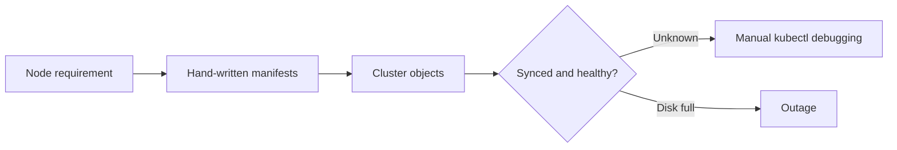
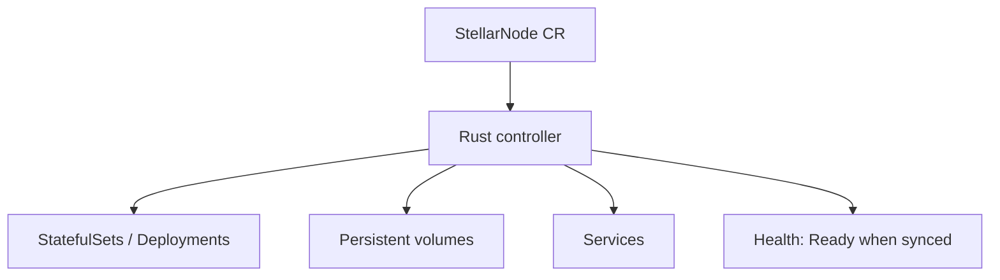
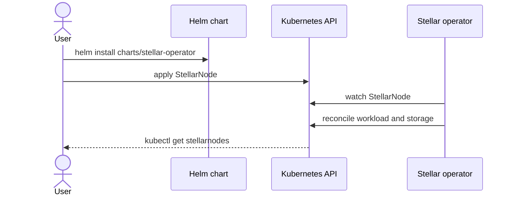

# PITCH Storyboards

Narrative storyboards for **Stellar-K8s**: why the project exists, who it is for, and how an operator uses the Kubernetes operator to run Stellar nodes.

> **Status:** Storyboards describe intent. Technical behavior is defined in the linked docs, not in this page.
>
> **Implemented vs proposed:** Items under [Implemented today](#implemented-today) match documented, shipped capabilities in this repository. Items under [Proposed](#proposed-not-claimed-as-shipped) come from the README roadmap checkboxes that are still open. Do not treat proposed items as production features.

## Table of Contents

- [Problem](#problem)
- [Intended users](#intended-users)
- [Proposed solution](#proposed-solution)
- [Implemented today](#implemented-today)
- [Proposed (not claimed as shipped)](#proposed-not-claimed-as-shipped)
- [User journeys](#user-journeys)
- [Expected value](#expected-value)
- [Related documentation](#related-documentation)

---

## Problem

**Storyboard: "Stellar nodes without an operator"**

| Scene | What happens | Friction |
| ----- | ------------ | -------- |
| 1 | A team needs a Testnet or Mainnet **validator**, **Horizon**, or **Soroban RPC** node on Kubernetes. | Core, Horizon, and RPC have different lifecycle, storage, and sync requirements. |
| 2 | They assemble Deployments, StatefulSets, PVCs, Secrets, and Services by hand. | Manifests drift; disk fills as the ledger grows; nodes look Ready before they are synced. |
| 3 | Failures leave orphaned volumes or unsynced RPC endpoints. | Cleanup and health are easy to get wrong without a controller. |

---

## Intended users

| User | Goal in this repo |
| ---- | ----------------- |
| Cluster operator | Install the operator and apply a `StellarNode` manifest ([Quick start](getting-started/quick-start.md), [Installation](getting-started/installation.md)). |
| Stellar infrastructure engineer | Run validators / Horizon / Soroban RPC with GitOps ([Argo CD](gitops/argocd.mdx), [Flux](gitops/flux.md)). |
| Contributor | Build and test the Rust operator ([CONTRIBUTING.md](../CONTRIBUTING.md), [DEVELOPMENT.md](../DEVELOPMENT.md)). |

---

## Proposed solution

Stellar-K8s is a **Kubernetes Operator** in Rust (`kube-rs`) that reconciles a `StellarNode` Custom Resource into cluster objects for Stellar Core, Horizon, and Soroban RPC.

Branding: [assets/logo.png](../assets/logo.png). Architecture detail: [Architecture overview](architecture/overview.md).

---

## Implemented today

Drawn from the README feature list and Phase 1 roadmap (checked items), not from unchecked future phases:

- `StellarNode` CRD and Helm chart for the operator (`charts/stellar-operator`)
- Controller with `kube-rs`, finalizers for PVC/resource cleanup
- Auto-sync health checks so Horizon and Soroban RPC are Ready only when synced
- Proactive disk / volume expansion as the ledger grows
- Prometheus metrics integration
- GitOps-oriented manifests and docs (Argo CD, Flux)
- `kubectl-stellar` plugin
- CI via [`.github/workflows/ci.yml`](https://github.com/OtowoOrg/Stellar-K8s/blob/main/.github/workflows/ci.yml)

---

## Proposed (not claimed as shipped)

From README **Roadmap Phase 2 and Phase 3** (unchecked):

- Broader Soroban RPC / captive-core completeness
- More comprehensive Prometheus metrics (for example ledger age, peer count) and dedicated Grafana dashboards
- Automated history archive management
- Automated HA failover, disaster-recovery automation, multi-region federation

Those items may already have design docs or samples elsewhere; this page does not treat them as complete product capabilities.

---

## User journeys

### Journey A — Deploy a Testnet validator (implemented path)

1. Clone the repository and install the operator from `./charts/stellar-operator` ([Installation](getting-started/installation.md)).
2. Apply a `StellarNode` with `nodeType: Validator` and `network: testnet` (see root [README.md](https://github.com/OtowoOrg/Stellar-K8s/blob/main/README.md) Quick Start).
3. Controller reconciles StatefulSet, storage, and config.
4. Operator reports node status; Horizon/RPC Ready waits for sync when those node types are used.

### Journey B — GitOps (documented)

1. Point Argo CD or Flux at this repository's examples and chart.
2. Promote `StellarNode` YAML through Git rather than imperative kubectl.
3. Follow [Argo CD](gitops/argocd.mdx) or [Flux](gitops/flux.md); do not assume extra sync tooling beyond what those docs describe.

### Journey C — Contributor (implemented process)

1. Read [README.md](https://github.com/OtowoOrg/Stellar-K8s/blob/main/README.md) and this page.
2. Follow [CONTRIBUTING.md](../CONTRIBUTING.md): `make dev-setup`, then `make health` / `make ci-local`.
3. Open a PR against `main`; [`.github/workflows/ci.yml`](https://github.com/OtowoOrg/Stellar-K8s/blob/main/.github/workflows/ci.yml) validates the change.

---

## Expected value

| Outcome | Basis |
| ------- | ----- |
| One CR for node intent | `StellarNode` CRD and samples in `examples/` |
| Safer lifecycle | Finalizers and typed Rust controller (README) |
| Fewer false-ready endpoints | Auto-sync health checks (README) |
| Fewer disk-full outages | Volume expansion (README) |

No quantitative SLA or cost figures are claimed here.

---

## Related documentation

- [README.md](https://github.com/OtowoOrg/Stellar-K8s/blob/main/README.md) — overview, features, roadmap
- [docs/README.md](README.md) — documentation index
- [Architecture overview](architecture/overview.md)
- [CONTRIBUTING.md](../CONTRIBUTING.md)

## Maintaining this document

- Keep implemented and proposed sections in sync with the README roadmap.
- Use relative links so the MkDocs site can resolve them.
- After edits, run `make nav-coverage` and `make docs-ci-build` when those tools are available locally.
